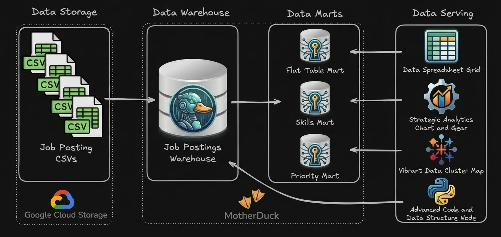
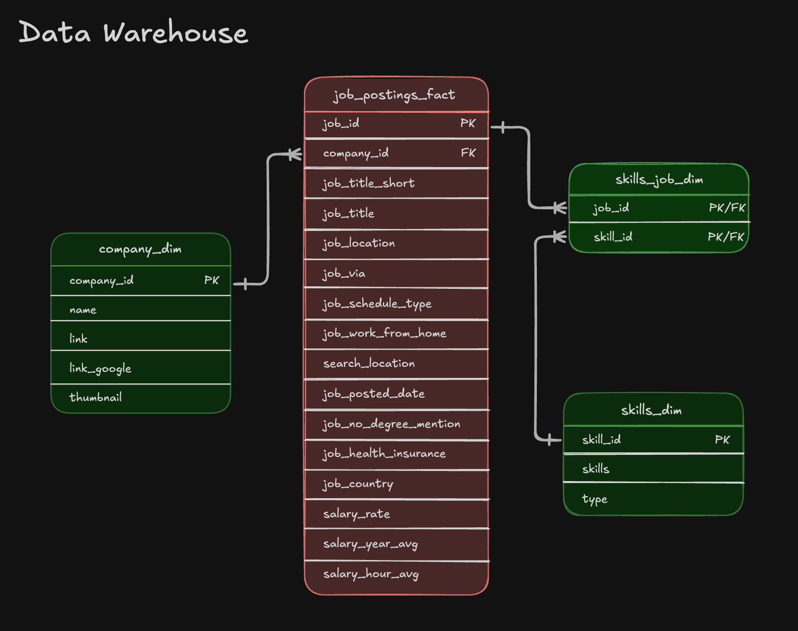

# 🏗️ Data Warehouse & Mart Build: DuckDB ETL Pipeline

An end-to-end DuckDB data engineering pipeline that loads job-posting CSV files from Google Cloud Storage into a relational star-schema data warehouse, then builds analytical marts for job-posting details, skill demand, priority roles, and company hiring trends.



---

## 🧾 Executive Summary (For Hiring Managers)

- ✅ **Pipeline scope:** Loads company, skill, job-posting, and job-skill relationship data, then prepares purpose-built datasets for analysis.
- ✅ **Data modeling:** Separates job postings (the fact table) from company and skill dimensions, with a bridge table for the many-to-many relationship between jobs and skills.
- ✅ **ETL development:** Uses DuckDB SQL to read CSVs from Google Cloud Storage, populate the warehouse in dependency order, and derive monthly and role-based aggregates.
- ✅ **Mart architecture:** Provides a flat job-posting table, a monthly skill-demand mart, a priority-role snapshot, and an optional company-hiring mart.

---

## 🧩 Problem & Context

Raw job posting data arrives as flat CSV files in Google Cloud Storage—not structured for analytical queries. Analysts need to answer:

- Which skills are most in-demand over time?
- What are hiring trends by company and location?
- How do salary patterns vary by role and skill?

The source files contain useful attributes, but the CSV layout does not by itself provide consistent relationships or convenient summary measures. For example, a posting can be associated with several skills, and hiring trends need to be grouped consistently by posting date, company, role, or location.

**Challenge:** Data teams need a single source of truth system—a data warehouse—to enable consistent, reliable analysis across the organization. Additionally, specialized data marts are required to optimize resources by pre-aggregating data for specific business use cases, reducing query complexity and improving performance for common analytical patterns.

Keeping the warehouse normalized helps preserve the source entities and their relationships, while the marts shape that data for recurring questions. The marts in these scripts pre-aggregate some measures (such as monthly skill counts and company hiring statistics); they are analytical outputs, not a replacement for the underlying warehouse.

**Solution:** End-to-end ETL pipeline that extracts CSVs from cloud storage, normalizes them into a star schema warehouse (separating facts from dimensions), and creates specialized data marts optimized for specific use cases (flat queries, skill demand analysis, priority role tracking).

The scripts first create the four warehouse tables, then load the two dimensions before the job fact and its skill bridge. They build each mart from those warehouse tables. The skills mart counts postings by skill, month, and short job title; the priority mart matches configured role names to postings; and the company mart summarizes postings, salary ranges, and selected posting attributes by company, role, country, and month.

---

## 🧰 Tech Stack

- ☁️ **Cloud database:** MotherDuck hosts the database and analytical tables, so the full dataset does not need to be stored on the laptop.
- 🦆 **SQL engine and client:** DuckDB CLI is used to connect to MotherDuck and run the SQL scripts.
- 🐳 **Container setup:** Docker Compose starts the DuckDB container and passes `MOTHERDUCK_TOKEN` into it. The interactive terminal is used to connect to the intended MotherDuck database.
- 🖥️ **Workflow:** Edit SQL files in VS Code, copy them into the running container when needed, then execute them from the DuckDB terminal with `.read`.
- 🌐 **External CSV access:** `02_load_schema_dw.sql` reads CSV files from Google Cloud Storage URLs. DuckDB's `httpfs` extension enables reading remote HTTP/S3-compatible files; it is relevant to those GCS URLs, not the Docker-to-MotherDuck connection itself.
- 🧮 **Language and modeling:** SQL for schema creation, data loading, transformations, and marts; the warehouse uses fact, dimension, and bridge tables.
- 📦 **Version control:** Git/GitHub for versioning the SQL scripts and project documentation.

> **Data-source note:** The setup connects the DuckDB client to MotherDuck, while the current warehouse-load script reads its input CSVs directly from Google Cloud Storage. These are separate parts of the workflow: GCS provides the CSV inputs, and MotherDuck is the cloud database where the connected session can build and query tables. Docker Compose also mounts local `datasets/` and `duckdb_local/` folders into the container for files and local DuckDB state; it does not copy the MotherDuck database onto the laptop.

---

## 📂 Repository Structure

```text
DW_Mart_Build/
├── 01_create_tables_dw.sql        # Star schema DDL
├── 02_load_schema_dw.sql          # GCS data extraction & loading
├── 03_create_flat_mart.sql        # Denormalized flat mart
├── 04_create_skills_mart.sql      # Skills demand mart
├── 05_create_priority_mart.sql    # Priority roles mart
├── 06_update_priority_mart.sql    # Priority mart incremental update (MERGE)
├── 07_create_company_mart.sql     # Company hiring mart (optional)
├── build_marts.sql                # Master SQL build script
└── README.md                       # You are here
```

Run the individual SQL files in numerical order in a DuckDB session after confirming the source CSV URLs are accessible. The master script is intended to run the same sequence, but its current `.read` commands use `/tmp/...` paths and its usage comments refer to a different filename; update those paths (or stage the scripts at the specified paths) before running it from this repository. It also includes the optional company mart by default.

---

## 🏗️ Pipeline Architecture


The pipeline transforms job posting CSVs from Google Cloud Storage into a normalized star schema data warehouse, then builds specialized analytical data marts. BI tools (Excel, Power BI, Tableau, Python) consume from both the warehouse and marts.

### Data Warehouse

The data warehouse implements a star schema with `company_dim`, `skills_dim`, `job_postings_fact`, and `skills_job_dim` tables.



- **SQL Files:**
  - [`01_create_tables_dw.sql`](./01_create_tables_dw.sql) – Defines star schema with 4 core tables
  - [`02_load_schema_dw.sql`](./02_load_schema_dw.sql) – Extracts CSVs from GCS and loads into warehouse tables
- **Purpose:** Star schema serving as single source of truth for analytical queries
- **Grain:** One row per job posting in the fact table (`job_postings_fact`)

### Flat Mart

Denormalized table with all dimensions for ad-hoc queries.

- **SQL File:** [`03_create_flat_mart.sql`](./03_create_flat_mart.sql) – Builds denormalized table with all dimensions joined
- **Purpose:** One query-friendly row per job posting, with the company name included and associated skills collected into an array of skill/type structs
- **Grain:** One row per `job_id`; left joins preserve postings even when company or skill details are missing

### Skills Mart

Time-series skill demand analysis with additive measures.

- **SQL File:** [`04_create_skills_mart.sql`](./04_create_skills_mart.sql) – Builds time-series skill demand mart
- **Purpose:** Time-series analysis of skill demand over time
- **Grain:** `skill_id + month_start_date + job_title_short`
- **Key Features:** Stores posting counts and counts of remote, health-insurance, and no-degree-mentioned flags. These counts can be summed across months or job titles for a given skill; because one posting can have multiple skills, totals across skills can count the same posting more than once.

### Priority Mart

Priority role tracking with incremental updates using MERGE operations.

- **SQL Files:**
  - [`05_create_priority_mart.sql`](./05_create_priority_mart.sql) – Initial build of priority roles and jobs snapshot
  - [`06_update_priority_mart.sql`](./06_update_priority_mart.sql) – **Incremental update using MERGE** (upsert pattern)
- **Purpose:** Track priority roles and job snapshots with incremental update capabilities
- **Grain:** One row per job posting with priority level assignment
- **Key Features:** `priority_roles` assigns levels to configured role names; the snapshot includes postings whose `job_title_short` exactly matches those names. The update script changes a role level, adds a sample role, and uses `MERGE` to update or insert snapshot rows and delete rows absent from the current source.
- **Rerun note:** The update script inserts `role_id = 4` without checking whether it already exists, so it is not safe to rerun unchanged after the first successful run.

### Company Mart (Optional)

Company hiring trends by role, country, and month.

- **SQL File:** [`07_create_company_mart.sql`](./07_create_company_mart.sql) – Builds company hiring trends mart (optional)
- **Purpose:** Company hiring trends by short job title, country, and month, including posting counts, annual salary median/minimum/maximum, and shares for remote, health-insurance, and no-degree-mentioned flags.
- **Grain:** `company_id + job_title_short_id + job_country + month_start_date` in the fact table.
- **Key Features:** Builds company, title, location, and month dimensions plus company-location and short-title/full-title bridge tables. The fact table groups by country (not `location_id`) and filters out postings with missing company, date, or country.
- **Note:** This mart is optional and can be skipped if not needed

---

## 💻 Data Engineering Skills Demonstrated

### ETL Pipeline Development

- **Extract:** Reads CSV files from the `sql_de` Google Cloud Storage bucket using DuckDB's HTTP support.
- **Transform:** Uses joins, date truncation, boolean-to-count conversions, and filters for selected null values.
- **Load:** Inserts data into dimensions before dependent fact/bridge tables; validation queries report row counts and orphaned references.
- **Snapshot maintenance:** The priority update demonstrates `MERGE` with matched updates, new-row inserts, and deletion of rows missing from the source.
- **Orchestration:** `build_marts.sql` lists the pipeline steps, but its current absolute `.read` paths need to be reconciled with the repository before it can be run as-is.

### Dimensional Modeling

- **Star Schema Design:** Fact table (`job_postings_fact`) with dimension tables (`company_dim`, `skills_dim`)
- **Bridge Tables:** Many-to-many relationship handling (`skills_job_dim`, `bridge_company_location`, `bridge_job_title`)
- **Grain Definition:** Explicit grains for monthly skill demand and company hiring facts
- **Additive Measures:** Skill-posting counts can be summed across months and job titles for a given skill. Company salary statistics and shares are not additive and should not be summed or averaged across groups without recalculating from underlying postings.
- **Surrogate Keys:** Sequential ID generation using CTEs with self-joins (optional company_mart build only)

### SQL Advanced Techniques

- **DDL Operations:** `CREATE TABLE`, `DROP TABLE`, `CREATE SCHEMA` for schema management
- **DML Operations:** `INSERT INTO ... SELECT` with explicit column mapping from CSV sources
- **MERGE Operations:** Demonstrates `MERGE INTO` with `WHEN MATCHED`, `WHEN NOT MATCHED`, and `WHEN NOT MATCHED BY SOURCE` clauses for snapshot synchronization
- **CTEs:** Common Table Expressions for complex transformations and boolean flag conversions
- **Date Functions:** `DATE_TRUNC('month')`, `EXTRACT(quarter)` for temporal dimension creation
- **Array/struct functions:** `ARRAY_AGG` and `STRUCT_PACK` to collect a posting's skills and their types in the flat mart
- **Boolean Logic:** `CASE WHEN` conversions for aggregating flags (remote, health insurance, no degree)

### Data Quality & Production Practices

- **Rerun behavior:** Warehouse tables are dropped and recreated by the first script, and mart schemas are dropped with `CASCADE` before rebuilds. These are destructive rebuilds, not side-effect-free reruns; the priority update script also has a fixed-ID insert that will conflict on a subsequent unchanged run.
- **Data Validation:** The warehouse load includes row-count and orphan-reference checks; mart scripts provide row counts and sample queries for inspection.
- **Type Safety:** Proper data type definitions (`VARCHAR`, `INTEGER`, `DOUBLE`, `BOOLEAN`, `TIMESTAMP`)
- **Schema Organization:** Separate schemas (`flat_mart`, `skills_mart`, `priority_mart`, `company_mart`) for logical separation
- **Validation limits:** The checks display results but do not enforce a pipeline-wide pass/fail gate.
